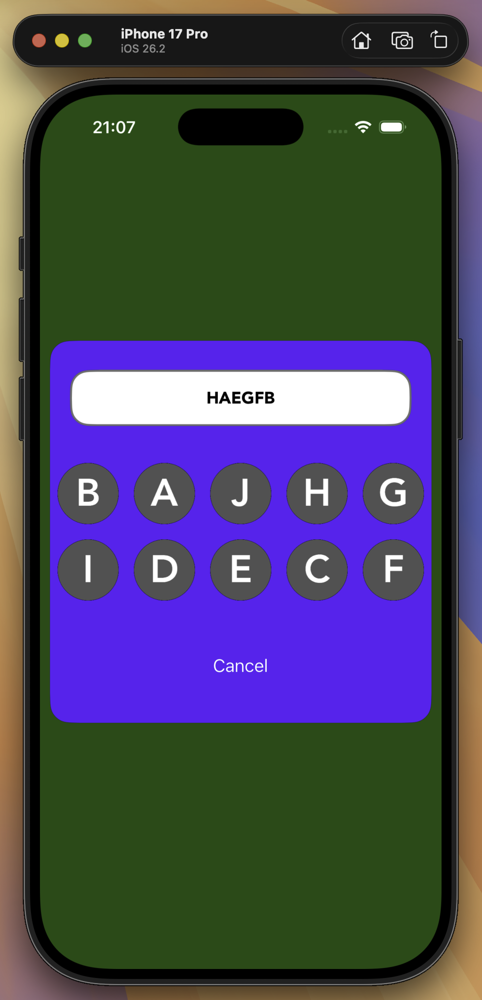

# RandomSeries

A small iOS app that builds letter sequences from a shuffled keypad.

<p align="center">
  
</p>

## How it works

- Ten round buttons, **A** to **J**, are laid out in a 2 × 5 grid in a **random order**.
- Tapping a button appends its letter to the display at the top.
- **Cancel** clears the display and reshuffles the keypad.

The shuffle is a Fisher–Yates algorithm written in **C++**, wrapped in **Objective-C++** and called from **Swift** through a bridging header.

## Requirements

- Xcode (the project was created with Xcode 12 and builds with current versions)
- iOS 14.5 or later

## Getting started

```sh
git clone <repository-url>
cd RandomSeries
open RandomSeries.xcodeproj
```

Select the **RandomSeries** scheme and an iPhone simulator, then run with ⌘R.

## Project structure

```
RandomSeries/
├── Commons/
│   ├── AppDelegate.swift       App entry point; creates the window in code
│   └── AppCommons.swift        Singleton: root view controller, colours, fonts, screen-based sizes
├── RandomSeriesVC.swift        Main screen: builds the interface and handles taps
├── StandardUI/                 UIKit subclasses configured in a single call
│   ├── StandardButton.swift
│   ├── StandardLabel.swift
│   └── StandardView.swift
├── Functions/
│   ├── BasicOp.hpp / .cpp      C++ Fisher–Yates shuffle
│   ├── BasicOpPack.h / .mm     Objective-C++ wrapper returning an NSMutableArray
│   └── RandomSeries-Bridging-Header.h
└── AppUI/
    ├── Assets.xcassets         App icon, letter images (A–J) and number images (0–9)
    └── Base.lproj/LaunchScreen.storyboard
```

### Call chain for the shuffle

```
RandomSeriesVC (Swift)
  └─ BasicOpPack.shuffledArray(withElements:)   Objective-C++
       └─ BasicOp::fisherYatesAlgoCPP(n)        C++
```

## Notes

- The interface is built entirely in code with frames; `Main.storyboard` and `SceneDelegate.swift` are leftovers from the Xcode template and are not used.
- The layout targets portrait orientation.
- The number images (`Zero` to `Nine`) are included but not used yet.

## Author

GK. © 2021. All rights reserved.
